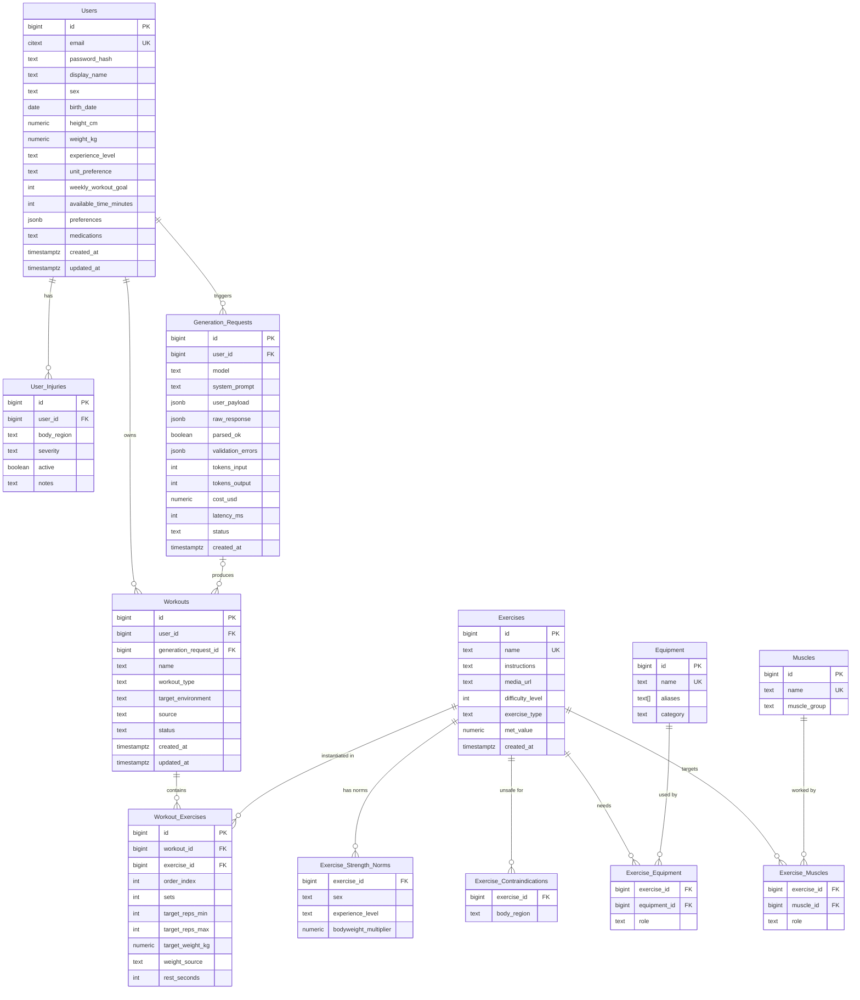

# Data Model — KinetiQ

**Status:** Approved (design phase)
**Last updated:** 2026-06-23

---

## Design Principles

These decisions govern the schema and are worth understanding before reading the tables.

1. **Store canonical SI units only.** `weight_kg`, `height_cm` are always stored in metric. The frontend converts to imperial based on `unit_preference`. Mixing units in storage is a reliable source of hard-to-trace bugs.

2. **Store facts — derive everything else.** Store `birth_date`, not `age` (age goes stale the moment it's saved). Never store `current_streak` — derive it from `Workout_History`. Never store muscle-volume indices — compute them from `Set_Logs`. Redundant derived data drifts out of sync.

3. **Lookup tables, not flat strings.** `Equipment` and `Muscles` are entities, not text columns. This makes aggregation, filtering, and mapping possible — required by the variety algorithm, the rule-based safety filter, and the future CV machine-identification feature.

4. **The safety filter is data, not code.** `Exercise_Contraindications ⨝ User_Injuries` turns "drop Deadlift for lower-back injuries" into a JOIN instead of brittle `if`-statements hardcoded in C++.

5. **Audit every LLM call.** `Generation_Requests` logs every AI interaction — prompt, response, cost, latency, and validation result. See [`§ LLM Audit Table`](#llm-audit-table--generation_requests) for the rationale.

6. **Rep ranges, not rep counts.** Real programming prescribes "8–12 reps," not a single number. `Workout_Exercises` uses `(target_reps_min, target_reps_max)`.

7. **Primary keys:** `BIGINT` identity (simple, fast, readable). UUIDs would prevent enumeration attacks on public IDs — consider migrating when the app goes public.

8. **Enum-like columns** (`role`, `status`, `experience_level`) are stored as `TEXT` enforced by `CHECK` constraints, not native Postgres `ENUM` types. Altering a Postgres enum type requires heavy migration work; CHECK constraints are trivially updated.

---

## ER Diagram



---

## Table Reference

### `Users`
Core user profile. Biometric and preference data.

| Column | Type | Notes |
|---|---|---|
| `id` | `BIGINT` PK | |
| `email` | `CITEXT` UNIQUE | Case-insensitive. Requires the `citext` extension. |
| `password_hash` | `TEXT` | argon2id hash. Never store plaintext. |
| `display_name` | `TEXT` | |
| `sex` | `TEXT` | `CHECK IN ('male','female','other','unspecified')` |
| `birth_date` | `DATE` | Age derived at query time: `DATE_PART('year', AGE(birth_date))` |
| `height_cm` | `NUMERIC(5,1)` | Always metric. |
| `weight_kg` | `NUMERIC(5,2)` | Current weight. Phase 4 adds `Body_Metrics` for history. |
| `experience_level` | `TEXT` | `CHECK IN ('beginner','intermediate','advanced')` |
| `unit_preference` | `TEXT` | `CHECK IN ('metric','imperial')`. Conversion is frontend-only. |
| `weekly_workout_goal` | `INT` | Target sessions per week. |
| `available_time_minutes` | `INT` | Per session. Constrains LLM generation. |
| `preferences` | `JSONB` | Flexible bag: preferred workout types, environments, etc. |
| `medications` | `TEXT` | Free-text in v1. Future: structured `User_Medications` table. |
| `created_at` / `updated_at` | `TIMESTAMPTZ` | All tables carry these. |

---

### `User_Injuries`
Many injuries per user. The rule-based safety layer JOINs this table to exclude contraindicated exercises before the LLM is ever called.

| Column | Type | Notes |
|---|---|---|
| `body_region` | `TEXT` | e.g. `lower_back`, `left_knee`. Must match values in `Exercise_Contraindications`. |
| `severity` | `TEXT` | `CHECK IN ('mild','moderate','severe')` |
| `active` | `BOOLEAN` | Inactive injuries are retained for history but excluded from the safety filter. |

---

### `Muscles` + `Exercise_Muscles`
Normalised muscle entities. Required for the volume-tracking and variety algorithms (Phase 5).

`Exercise_Muscles.role`: `CHECK IN ('primary','secondary')`

Seed data includes all major muscle groups: pectorals, anterior/lateral/posterior deltoid, biceps, triceps, lats, traps, rhomboids, erector spinae, rectus abdominis, obliques, glutes, quads, hamstrings, calves.

---

### `Equipment` + `Exercise_Equipment`
Normalised equipment entities.

`Equipment.aliases` (`TEXT[]`): alternative commercial names, used for fuzzy matching in the Phase 5 CV machine-identification feature.

`Exercise_Equipment.role`: `CHECK IN ('required','assisted')` — `required` means no alternative; `assisted` means the exercise is executable without it but benefits from it.

---

### `Exercise_Contraindications`
Maps exercises to body regions they are unsafe for. This is the data layer behind the rule-based safety filter.

```
JOIN User_Injuries ui ON ui.user_id = :user_id AND ui.active = true
JOIN Exercise_Contraindications ec ON ec.body_region = ui.body_region
```

Any `exercise_id` that appears in this JOIN result is removed from the pool before the LLM payload is built.

---

### `Exercises`
The core exercise catalogue. Seeded manually; updated by admin tooling.

| Column | Type | Notes |
|---|---|---|
| `difficulty_level` | `INT` | 1–5 scale. `CHECK BETWEEN 1 AND 5` |
| `met_value` | `NUMERIC(4,2)` | Used in deterministic calorie formula: `calories = MET × weight_kg × duration_hours` |
| `exercise_type` | `TEXT` | e.g. `strength`, `cardio`, `mobility`, `plyometric` |

---

### `Exercise_Strength_Norms`
Reference data for the deterministic **Starting-Weight Engine**. For exercises with published
strength standards (mostly compound barbell/dumbbell lifts), this stores a typical working
weight as a multiple of bodyweight, broken down by sex and experience level.

| Column | Type | Notes |
|---|---|---|
| `exercise_id` | `BIGINT` FK | Composite PK with `sex` + `experience_level`. |
| `sex` | `TEXT` | `CHECK IN ('male','female')` — norms are sex-specific. |
| `experience_level` | `TEXT` | `CHECK IN ('beginner','intermediate','advanced')` |
| `bodyweight_multiplier` | `NUMERIC(4,2)` | Suggested weight = `multiplier × user.weight_kg`, rounded to the nearest plate increment (2.5 kg). |

Coverage is intentionally partial: only exercises with credible norms get rows. Exercises with
no row (accessories, machines, bodyweight movements) fall back to user-entered weight. The LLM
never sets weights — this engine does, deterministically, *after* generation. See
[`docs/03-llm-port.md`](./03-llm-port.md).

---

### `Workouts`
A workout plan — AI-generated or manually created.

| Column | Type | Notes |
|---|---|---|
| `generation_request_id` | `BIGINT` FK | Nullable. Links to the exact LLM call that created this plan. |
| `source` | `TEXT` | `CHECK IN ('ai','manual')` |
| `status` | `TEXT` | `CHECK IN ('draft','active','archived')` |

---

### `Workout_Exercises`
The junction table. One row per exercise slot in a workout, carrying the AI-customised prescription.

`target_weight_kg` is nullable. Its companion `weight_source` records *where the number came from*:

| `weight_source` | Meaning | Frontend behaviour |
|---|---|---|
| `body_type_estimate` | Filled by the Starting-Weight Engine from `Exercise_Strength_Norms` | Show "starting weight is an average for your body type — adjust to your liking" |
| `needs_user_input` | No norm available, or insufficient profile data; `target_weight_kg` is `NULL` | Prompt the user to enter a target weight |
| `user_set` | The user manually set or edited the weight | Show the value as-is |

In all cases the user can change the weight; doing so flips `weight_source` to `user_set`.

---

## LLM Audit Table — `Generation_Requests`

Every call to the LLM API produces one row here, regardless of success or failure. This table is one of the most important architectural decisions in the backend.

### Why it exists

**Debuggability.** When a generated workout looks wrong — wrong exercises, too many sets, an injury-contraindicated movement that slipped through — you can inspect the exact system prompt, the exact user payload that was sent, and the exact raw response that came back. Without this, debugging AI behaviour is guesswork.

**Validation traceability.** The C++ backend validates the LLM response (schema compliance, exercise IDs exist, duration within user's time budget, etc.). `parsed_ok` and `validation_errors` record the outcome. If the validator rejected the response and triggered a retry, that retry is a separate row.

**Cost and latency observability.** `tokens_input + tokens_output + cost_usd + latency_ms` per request. Across many rows you can answer: what does a plan generation cost on average? Which user profiles produce long prompts? Where is latency coming from? This data powers a monitoring dashboard — a strong portfolio addition.

**Prompt iteration.** As you refine the system prompt, you compare the distribution of `parsed_ok`, `validation_errors`, and `latency_ms` across prompt versions. The table is your evaluation harness.

**`Workouts.generation_request_id`** creates the traceability link: from any AI-generated plan, you can retrieve the audit row that created it.

---

## Deferred Tables (Phase 4+)

These are designed-for but not built in v1. The current schema accommodates them without migrations.

| Table | Phase | Purpose |
|---|---|---|
| `Workout_History` | 4 | Completion metadata per session |
| `Set_Logs` | 4 | Actual reps/weight/RPE per set — source of truth for the feedback loop |
| `Body_Metrics` | 4 | Time-series weight log for accurate historical calorie math |
| `Friendships` | 5 | Opt-in social graph for motivational sharing (see Scope note below) |

---

## Scope Note — Social Features

The full social comparison feature (leaderboards, `UserShareDTO`, streak sharing) is deferred. The one social-facing feature retained for motivational value is **friend workout updates**: a lightweight feed showing friends' recent workout completions (workout type, date) with no biometric or medical data exposed. This maps to `Workout_History` (Phase 4) — no new tables required.
