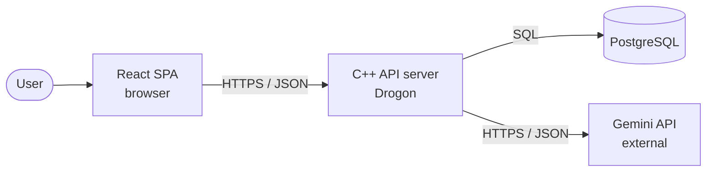
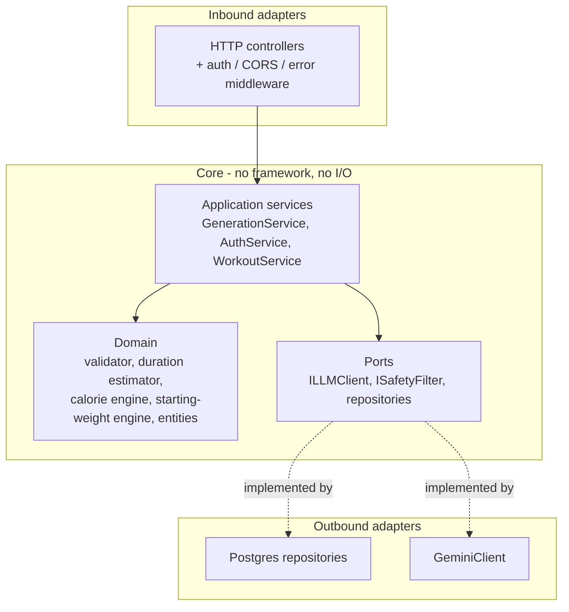
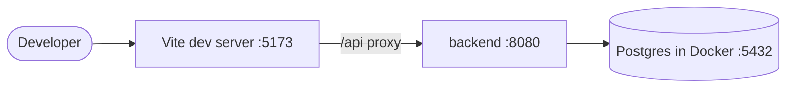

# System Architecture — Fit App (v1)

**Status:** Approved (design phase)
**Last updated:** 2026-06-24
**Related:** [`01-data-model.md`](./01-data-model.md) · [`02-api-contract.md`](./02-api-contract.md) · [`03-llm-port.md`](./03-llm-port.md) · [ADRs](./adr/README.md)

This document describes how the system is structured: the high-level components, the internal
layering of the C++ backend (Hexagonal / Ports & Adapters), the React frontend structure, the
folder layouts, and the cross-cutting concerns.

---

## 1. System context



- **React SPA** — the only thing the user touches; talks to the backend over the REST contract (`02`).
- **C++ API server** — owns all business logic, persistence, and AI orchestration.
- **PostgreSQL** — the single source of truth (`01`).
- **Gemini API** — external LLM, reached only through the `ILLMClient` port (`03`).

---

## 2. Backend internal architecture (Hexagonal / Ports & Adapters)

The core depends on **interfaces (ports)**; concrete technology lives in **adapters** at the edges.
Dependencies always point *inward* (toward the domain). See [ADR-0002](./adr/0002-hexagonal-architecture.md).



**Layer responsibilities**

| Layer | Responsibility | Knows about |
|---|---|---|
| HTTP controllers (inbound adapter) | Parse request, auth, call a service, map result/errors to HTTP | Drogon, JSON, services |
| Application services | Orchestrate a use case (the steps of `/generate`, login, etc.) | Domain + ports only |
| Domain | Pure business rules; deterministic logic; entities | Nothing external |
| Ports | Interfaces the core needs | Nothing external |
| Outbound adapters | Implement ports against real tech | Postgres / Gemini / HTTP |

**The rule that keeps it clean:** the core (`app` + `domain` + `ports`) must compile and be fully
testable **without** Drogon, Postgres, or the network. Adapters are wired in at `main()`
(dependency injection) and swapped for fakes in tests.

---

## 3. Backend folder layout

```
backend/
├── CMakeLists.txt
├── vcpkg.json                 # declared dependencies (ADR-0005)
├── src/
│   ├── main.cpp               # composition root: build adapters, inject, start server
│   ├── http/                  # inbound adapter
│   │   ├── controllers/       # AuthController, UserController, WorkoutController, ...
│   │   ├── middleware/        # JWT auth -> CurrentUser, CORS, error mapping
│   │   └── dto/               # request/response DTOs + (de)serialization
│   ├── app/                   # application services (use cases)
│   ├── domain/                # entities, validator, estimators, engines (pure)
│   ├── ports/                 # ILLMClient, ISafetyFilter, I*Repository
│   ├── adapters/
│   │   ├── db/                # Postgres repository implementations
│   │   └── llm/               # GeminiClient
│   └── config/                # env/config loading
├── tests/
│   ├── unit/                  # domain + services against fakes
│   ├── integration/           # repositories vs ephemeral Postgres
│   ├── contract/              # boot app, hit real endpoints
│   └── fakes/                 # FakeLLMClient, in-memory repositories
└── migrations/                # ordered SQL migration files
```

The single place that knows *all* concrete technologies is `main.cpp` (the **composition root**).

---

## 4. Frontend structure (React + TypeScript + Vite)

See [ADR-0010](./adr/0010-frontend-stack.md). Feature-folder organisation keeps related code together.

```
frontend/
├── package.json
├── vite.config.ts
├── index.html
└── src/
    ├── main.tsx               # entry
    ├── app/                   # router + providers (QueryClient, auth)
    ├── pages/                 # route-level screens
    ├── features/              # one folder per domain area
    │   ├── auth/
    │   ├── profile/
    │   ├── exercises/
    │   └── workouts/
    │       ├── api/           # TanStack Query hooks calling the REST API
    │       ├── components/
    │       └── types/
    ├── components/            # shared UI (shadcn/ui)
    ├── lib/                   # api client, unit conversion, helpers
    ├── hooks/                 # shared hooks
    └── test/                  # Vitest setup + MSW handlers (mock the API contract)
```

**Frontend ↔ backend boundary:** the only contract between them is `02-api-contract.md` (later the
OpenAPI file). The frontend converts metric→imperial for display based on `unit_preference`;
the wire is always metric.

---

## 5. Cross-cutting concerns

| Concern | Approach (v1) |
|---|---|
| **Config & secrets** | Env vars loaded in `config/`. `GEMINI_API_KEY`, `DATABASE_URL`, `JWT_SECRET`. `.env` is git-ignored; a committed `.env.example` documents required keys. |
| **Auth** | JWT verified in one middleware that produces a `CurrentUser`; nothing else decodes tokens (ADR-0006). |
| **Error handling** | Core returns `Result`/`std::expected`; the HTTP layer maps errors to RFC 9457 Problem Details (`02`). No exceptions cross the API boundary. |
| **Validation** | Request DTO validation at the HTTP edge; domain invariants in the domain layer. |
| **Logging** | Structured logging (e.g. spdlog) with a per-request id. |
| **CORS** | Dev: allow the Vite origin. |
| **DB migrations** | Ordered SQL files in `migrations/`, applied on startup or via a script. |
| **AI observability** | `Generation_Requests` table is the audit/flight-recorder (`03`). |

---

## 6. Local environment



`docker-compose.yml` runs Postgres (and later the backend). The Vite dev server proxies `/api`
to the backend to avoid CORS friction during development.

---

## 7. How this maps to testing

| Test layer | What runs | Adapters used |
|---|---|---|
| Unit | domain + application services | fakes (FakeLLMClient, in-memory repos) |
| Integration | Postgres repositories | real Postgres (Docker), fake LLM |
| Contract / E2E | full app over HTTP | real Postgres, fake or recorded LLM |

The hexagonal boundaries are exactly what make each layer cheap to test — see the dedicated test
strategy doc (planned next) for the full TDD workflow and CI.
