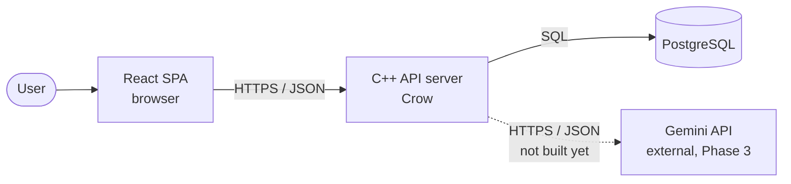

# System Architecture — Fit App (v1)

**Status:** Approved — kept in sync with implementation as Phases 1-2 land (was a pre-build design
doc as of 2026-06-24; corrected against actual code 2026-07-16 after Phase 1 + Slice 1 (Auth)).
**Last updated:** 2026-07-16
**Related:** [`01-data-model.md`](./01-data-model.md) · [`02-api-contract.md`](./02-api-contract.md) · [`03-llm-port.md`](./03-llm-port.md) · [`phase-2-slice-1-auth.md`](./phase-2-slice-1-auth.md) · [ADRs](./adr/README.md)

This document describes how the system is structured: the high-level components, the internal
layering of the C++ backend (Hexagonal / Ports & Adapters), the React frontend structure, the
folder layouts, and the cross-cutting concerns. **Sections marked "as built" describe real,
tested, running code; sections marked "planned" describe intended future structure that doesn't
exist yet** (notably §4, the frontend — still a Phase-1 walking skeleton).

---

## 1. System context



- **React SPA** — the only thing the user touches; talks to the backend over the REST contract (`02`).
- **C++ API server** — owns all business logic, persistence, and AI orchestration. Built on
  **Crow** (header-only, vendored at `Server/third_party/crow/crow_all.h`), not Drogon — see
  [ADR-0011](./adr/0011-web-framework-crow.md) (supersedes [ADR-0003](./adr/0003-cpp-web-framework-drogon.md),
  which named Drogon; that build OOM'd on the 8GB dev machine).
- **PostgreSQL** — the single source of truth (`01`).
- **Gemini API** — external LLM, reached only through the `ILLMClient` port (`03`). **Phase 3,
  not built yet** — Phases 1-2 (walking skeleton, core domain incl. auth) are non-AI.

---

## 2. Backend internal architecture (Hexagonal / Ports & Adapters)

The core depends on **interfaces (ports)**; concrete technology lives in **adapters** at the edges.
Dependencies always point *inward* (toward the domain). See [ADR-0002](./adr/0002-hexagonal-architecture.md).

```mermaid
flowchart TB
    subgraph Adapters_In [Inbound adapters]
        HTTP[HTTP controllers<br/>Crow route handlers]
        AUTH[authenticate&#40;&#41;<br/>plain function, NOT middleware]
    end

    subgraph Core [Core - no framework, no I/O]
        APP[Application services<br/>RegisterUser, LoginUser, ChangePassword,<br/>&#40;planned&#41; GenerationService, WorkoutService]
        DOMAIN[Domain<br/>User, PasswordPolicy,<br/>&#40;planned&#41; duration estimator, calorie engine,<br/>starting-weight engine]
        PORTS[Ports<br/>IUserRepository, IPasswordHasher, ITokenService,<br/>&#40;planned&#41; ILLMClient, ISafetyFilter]
    end

    subgraph Adapters_Out [Outbound adapters]
        PG[Postgres repositories<br/>PgUserRepository, AutoCommitPgUserRepository]
        CRYPTO[Argon2PasswordHasher, JwtTokenService]
        GEM[GeminiClient<br/>planned, Phase 3]
    end

    HTTP --> AUTH
    HTTP --> APP
    AUTH --> PORTS
    APP --> DOMAIN
    APP --> PORTS
    PORTS -. implemented by .-> PG
    PORTS -. implemented by .-> CRYPTO
    PORTS -. implemented by .-> GEM
```



**Layer responsibilities**

| Layer | Responsibility | Knows about |
|---|---|---|
| HTTP controllers (inbound adapter) | Parse request, call `authenticate()` for protected routes, call a service, catch its exceptions, map to HTTP status + RFC 9457 body | Crow, JSON, services |
| Application services (`app/`) | Orchestrate a use case (e.g. `RegisterUser::execute`: validate → hash → persist → issue token) | Domain + ports only |
| Domain | Pure business rules; deterministic logic; entities (`User`, `PasswordPolicy`) | Nothing external |
| Ports | Interfaces the core needs (`IUserRepository`, `IPasswordHasher`, `ITokenService`) | Nothing external |
| Outbound adapters | Implement ports against real tech | Postgres / argon2 / jwt-cpp / (planned) Gemini |

**The rule that keeps it clean:** the core (`app` + `domain` + `ports`) must compile and be fully
testable **without** Crow, Postgres, or the network. Adapters are wired in at `main()`
(dependency injection) and swapped for fakes in tests.

**Deliberate departure from a "textbook" hexagonal setup: auth is a plain function, not
middleware.** Crow's real-server request path runs middleware, but the in-process HTTP test
harness (`tests/support/HttpClient.h`, used everywhere in this codebase to test routes without a
socket) drives requests through `app.handle_full()`, which **does not run middleware at all** —
and would even dereference an uninitialized context if a route declared any. So `#17` built
`authenticate()` (`Server/src/http/middleware/Authenticator.h`) as a function protected handlers
call directly, independently unit-tested against valid/missing/malformed/expired tokens. This
keeps 100% of the HTTP layer — including 401 responses — testable in-process. Not yet captured as
its own ADR (tracked as a gap; would be ADR-0013).

---

## 3. Backend folder layout (as built, 2026-07-16)

```
Server/
├── CMakeLists.txt             # NOT vcpkg -- MSYS2 prebuilt deps + CMake FetchContent
│                              #   (ADR-0012 supersedes ADR-0005's vcpkg plan; no vcpkg.json exists)
├── third_party/crow/          # vendored single-header Crow (ADR-0011)
├── src/
│   ├── main.cpp               # composition root: build adapters, inject, start server
│   ├── http/                  # inbound adapter
│   │   ├── controllers/       # AuthController (built); UserController etc. planned (Slice 2+)
│   │   ├── middleware/        # Authenticator.h -- a plain fn, NOT Crow middleware (see §2)
│   │   └── dto/               # request/response DTOs + (de)serialization (AuthDto.h)
│   ├── app/                   # application services: RegisterUser, LoginUser, ChangePassword
│   ├── domain/                # User, PasswordPolicy (pure, no I/O)
│   ├── ports/                 # IUserRepository, IPasswordHasher, ITokenService
│   │                          #   (planned: ILLMClient, ISafetyFilter -- Phase 3)
│   ├── adapters/
│   │   ├── db/                # Migrator, PgUserRepository, AutoCommitPgUserRepository
│   │   │                      #   (planned: llm/GeminiClient -- Phase 3)
│   │   └── crypto/            # Argon2PasswordHasher, JwtTokenService
│   └── config/                # Env.h -- env var loading
├── tests/                     # flat -- NOT split into unit/integration/contract/fakes dirs
│   ├── test_*.cpp             # one file per unit under test, e.g. test_register_user.cpp
│   └── support/                # TestDb (DbTest fixture), HttpClient (in-process, no socket),
│                               #   InMemoryUserRepository (hand-written fake, no gmock)
└── migrations/                # ordered SQL migration files, applied by Migrator on startup
```

The single place that knows *all* concrete technologies is `main.cpp` (the **composition root**).
Full narrative of how this grew, decision by decision, in
[`phase-2-slice-1-auth.md`](./phase-2-slice-1-auth.md).

---

## 4. Frontend structure (React + TypeScript + Vite) — **planned, not yet built**

See [ADR-0010](./adr/0010-frontend-stack.md). Feature-folder organisation keeps related code
together. **As of 2026-07-16, `Client/` is still the Phase 1 walking skeleton** — just
`main.tsx` + `App.tsx` calling `/api/v1/health` and rendering the status. None of the structure
below exists yet; it's the intended shape once `#24` (Client auth UI, Slice 1's last piece) and
Slice 2+ frontend work begin.

```
Client/
├── package.json
├── vite.config.ts
├── index.html
└── src/
    ├── main.tsx               # entry
    ├── app/                   # router + providers (QueryClient, auth)
    ├── pages/                 # route-level screens
    ├── features/              # one folder per domain area
    │   ├── auth/
    │   ├── profile/
    │   ├── exercises/
    │   └── workouts/
    │       ├── api/           # TanStack Query hooks calling the REST API
    │       ├── components/
    │       └── types/
    ├── components/            # shared UI (shadcn/ui)
    ├── lib/                   # api client, unit conversion, helpers
    ├── hooks/                 # shared hooks
    └── test/                  # Vitest setup + MSW handlers (mock the API contract)
```

**Frontend ↔ backend boundary:** the only contract between them is `02-api-contract.md` (later the
OpenAPI file). The frontend converts metric→imperial for display based on `unit_preference`;
the wire is always metric.

---

## 5. Cross-cutting concerns

| Concern | Approach (v1) |
|---|---|
| **Config & secrets** | Env vars loaded via `config/Env.h`'s `envOr(key, fallback)`. As built: `DB_HOST`/`DB_PORT`/`DB_NAME`/`DB_USER`/`DB_PASSWORD` (separate vars, not one `DATABASE_URL`), `BIND_ADDR`, `MIGRATIONS_DIR`, `JWT_SECRET`. Most have dev-safe fallbacks; `JWT_SECRET`'s fallback logs a startup warning if used (a guessable JWT secret lets anyone forge a valid login token — worse than a default DB password). `GEMINI_API_KEY` planned (Phase 3, unused so far). |
| **Auth** | **Not middleware** — a plain `authenticate()` function (`http/middleware/Authenticator.h`) that protected handlers call directly, producing a `CurrentUser` or triggering `401`. Departure from the original middleware plan; see §2 for why (ADR-0006 covers the JWT choice itself, which still holds — short-lived access tokens, 24h expiry, no refresh tokens in v1). |
| **Error handling** | **As built: C++ exceptions**, not `Result`/`std::expected`. Domain/app/ports code throws specific types (`WeakPasswordError`, `DuplicateEmailError`, `InvalidCredentialsError`); the HTTP controller catches them and maps to RFC 9457 Problem Details (`02`) — catch order matters, since several of these share a common base (`std::runtime_error`) and must be caught most-specific-first. |
| **Validation** | Request DTO validation at the HTTP edge (missing/wrong-typed JSON fields → `422`); domain invariants (e.g. password strength) enforced in the domain layer as guard clauses, checked before any I/O. |
| **Logging** | Crow's built-in `CROW_LOG_*` macros as built (`CROW_LOG_INFO`, `CROW_LOG_WARNING`, `CROW_LOG_ERROR`). No structured/per-request-id logging yet — plain text to stdout. |
| **CORS** | Dev: `Access-Control-Allow-Origin: *` header on responses (health check today; auth routes don't need it yet since the Vite proxy avoids cross-origin calls in dev). |
| **DB migrations** | Ordered SQL files in `migrations/`, applied by `Migrator` (`adapters/db/Migrator.h/.cpp`) on server startup — not a separate script. Fails closed: refuses to start if migrations can't apply. |
| **AI observability** | `Generation_Requests` table is the audit/flight-recorder (`03`). Phase 3, not built yet. |
| **DB transactions per request** | Repositories used at HTTP-request time (e.g. `AutoCommitPgUserRepository`) open a fresh connection + transaction *per call*, not per request — routes are registered once at startup and can't safely share one long-lived transaction across a multithreaded server's concurrent requests. Known limitation: multi-step use cases don't get cross-call atomicity (see `phase-2-slice-1-auth.md`'s 2026-07-16 decision on this). |

---

## 6. Local environment


`docker-compose.yml` runs Postgres (and later the backend). The Vite dev server proxies `/api`
to the backend to avoid CORS friction during development. Recommended launch: `scripts/run-dev.ps1
-Target server|client` (not the raw exe/`npm run dev`) — binds the process tree to a Windows Job
Object so it's killed automatically if the launcher dies for any reason, instead of orphaning and
squatting the port for the next session (see `docs/learning/how-to-run.md`).

---

## 7. How this maps to testing (as built)

| Test layer | What runs | Adapters used | DB? |
|---|---|---|---|
| Domain unit | pure validators (`PasswordPolicy`) | none | no |
| Service unit | `app/` use cases (`RegisterUser`, `LoginUser`, `ChangePassword`) | `InMemoryUserRepository` (hand-written fake, no gmock); real `Argon2PasswordHasher`/`JwtTokenService` (no fakes built yet — deferred until real argon2 cost actually hurts test speed) | no |
| Adapter integration | `PgUserRepository` | real Postgres, `DbTest` fixture (dedicated test DB + per-test transaction rollback) | yes |
| HTTP in-process | routes/handlers/DTOs (`AuthController`) | `HttpClient` drives Crow via `app.handle_full()` — real routing, **no socket, no middleware** (see §2) | mixed (fakes in these tests) |
| Frontend | planned — components + flows, API mocked | Vitest + Testing Library + MSW | no |

The hexagonal boundaries are exactly what make each layer cheap to test. Full TDD workflow +
rhythm in `docs/phase-2-plan.md` §7-8; a live example of the whole pyramid being built layer by
layer, with every red→green step narrated, in `docs/phase-2-slice-1-auth.md`.
